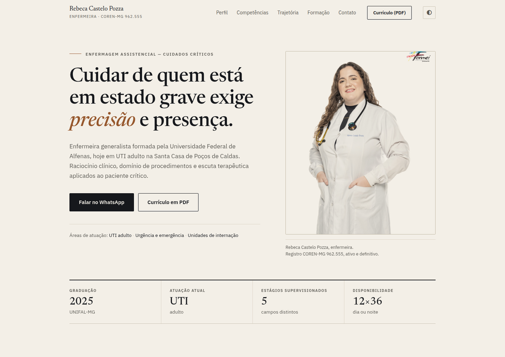

# Portfólio Profissional - Enfermagem 👩‍⚕️

 

Uma Landing Page responsiva e moderna desenvolvida para uma profissional de enfermagem recém-graduada. O objetivo do projeto é apresentar competências técnicas, histórico de estágios e facilitar o contato com recrutadores.

A direção visual é editorial e impressa: fundo de papel, tipografia serifada nos títulos, réguas de 1px no lugar de sombras e apenas dois acentos de cor (azul-marinho e ocre).

🔗 **[Clique aqui para ver o projeto online](https://portifolio-git-main-mateus-henrique-martins-projects.vercel.app/index.html)**

## 📱 Preview



## 🚀 Funcionalidades

- **Design Responsivo:** Layout adaptável para Celulares, Tablets e Desktops.
- **Tema Claro e Escuro:** Alternância manual com preferência salva no navegador e respeito ao tema do sistema.
- **Trajetória Filtrável:** Histórico profissional e de estágios em um registro único, com filtro por tipo.
- **Ficha Profissional:** Registro COREN, formação, cargo atual, escalas e áreas de interesse em uma lista de leitura rápida.
- **Competências e Protocolos:** Colunas temáticas e inventário de procedimentos dominados (VM, drogas vasoativas, SBV/SAV, ECG etc.).
- **Download de Currículo:** Botão direto para o PDF do CV no menu, no hero e no contato.
- **FAQ (Acordeão):** Perguntas frequentes de recrutadores, acessível via teclado (`aria-expanded`).
- **Contato Direto:** WhatsApp, e-mail, LinkedIn e botão flutuante de conversa.
- **Barra de Progresso e Menu Ativo:** Indicador de leitura no topo e destaque automático da seção visível.
- **Animações on Scroll:** Elementos surgem suavemente ao rolar, desativadas automaticamente com `prefers-reduced-motion`.
- **Acessibilidade:** Skip link, marcos semânticos, foco visível e contraste revisado nos dois temas.

## 🛠️ Tecnologias Utilizadas

O projeto foi construído utilizando tecnologias nativas (Vanilla), garantindo alta performance e carregamento rápido.

- **HTML5:** Estrutura semântica e acessível.
- **CSS3:** Flexbox, Grid Layout, Design Tokens (variáveis CSS), `clamp()`, `mix-blend-mode` e Media Queries.
- **JavaScript (Vanilla):** Tema, menu mobile, acordeão, filtro da timeline, progresso de rolagem e IntersectionObserver.
- **FontAwesome:** Ícones vetoriais via CDN.
- **Google Fonts:** Tipografia (Newsreader nos títulos e IBM Plex Sans no texto).

## 📂 Estrutura do Projeto

A organização de pastas segue o padrão de separação de responsabilidades (assets):

```bash
portifoliopessoalsaude/
│
├── index.html              # Arquivo principal
├── README.md               # Documentação
│
└── assets/                 # Recursos estáticos
    ├── style/
    │   └── style.css       # Estilização global e responsividade
    │
    ├── js/
    │   └── script.js       # Lógica do menu, animações e FAQ
    │
    ├── images/             # Fotos de perfil, icons e preview
    │   ├── fotopessoa1.jpg
    │   └── image.png
    │
    └── documents/          # Arquivos para download
        └── Rebeca_Castelo_Enfermeira.pdf
```
## 🔧 Como Executar

Este é um projeto estático, não requer instalação de dependências (como Node.js).

1. **Clone este repositório:**
   ```bash
   git clone [https://github.com/mateus0205/portifoliopessoalsaude.git](https://github.com/mateus0205/portifolioPessoalSaude.git)
    ```
2. **Abra o projeto:**
   Navegue até a pasta e abra o arquivo `index.html` no seu navegador preferido.

> **Dica:** Para desenvolvimento, recomenda-se usar a extensão "Live Server" do VS Code.

## 🎨 Personalização

Para adaptar este projeto para outro profissional:

- **Textos:** Edite o conteúdo diretamente no `index.html`.
- **Cores:** Altere as variáveis `:root` (tema claro) e `:root[data-theme="dark"]` (tema escuro) no início do arquivo `assets/style/style.css` para mudar a paleta rapidamente.
- **Imagens:** Substitua a foto em `assets/images/` mantendo as proporções.

## 👨‍💻 Autor

Desenvolvido por **Mateus Henrique Martins**.